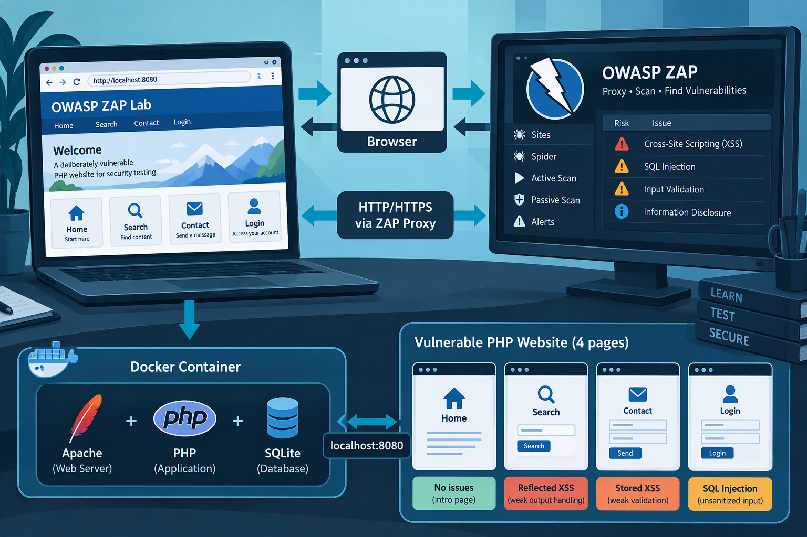

# OWASP ZAP oefenlab

> DISCLAIMER: veel code is gegenereerd via AI (Copilot)! Ook afbeeldingen en toelichtingen zijn met AI samengesteld.

Een bewust kwetsbare oefenwebsite met vier pagina's, gebouwd met **PHP 8.3**, **Apache** en **Docker Compose**. Je kunt
de website gebruiken om het ontdekken en testen van webkwetsbaarheden met **OWASP ZAP** te demonstreren.

> **Veiligheidswaarschuwing:** dit project bevat opzettelijke kwetsbaarheden. Gebruik het uitsluitend in een
> geïsoleerde, lokale testomgeving. Stel de container niet bloot aan internet of een bedrijfsnetwerk en gebruik geen echte
> accounts of persoonsgegevens.

## 1. Overzicht



De browser stuurt verkeer via ZAP naar de website op `localhost:8080`. Docker voert Apache en PHP uit; de demo gebruikt
SQLite voor de loginpagina.

## 2. Inhoud van de website

| Pagina        | Doel                             | Bewuste kwetsbaarheid                                          |
|---------------|----------------------------------|----------------------------------------------------------------|
| `index.php`   | Startpagina en navigatie         | Geen specifieke kwetsbaarheid                                  |
| `search.php`  | Zoeken op een zoekterm           | Reflected Cross-Site Scripting (XSS) en onveilige HTML-uitvoer |
| `contact.php` | Contactbericht plaatsen en tonen | Zwakke invoervalidatie en Stored XSS                           |
| `login.php`   | Inloggen met demo-account        | SQL Injection door SQL-query-opbouw met gebruikersinvoer       |

De database wordt automatisch aangemaakt in de persistente Docker-volume `lab_data`.

## 3. Benodigdheden

- Docker Desktop (Windows/macOS) of Docker Engine (Linux)
- Docker Compose v2 (`docker compose`)
- OWASP ZAP, bij voorkeur de desktopversie
- Een moderne browser

## 4. Installatie en starten

1. Pak het project uit naar een lokale map, bijvoorbeeld `owasp-zap-lab`.
2. Open een terminal in die map, op dezelfde locatie als `docker-compose.yml`.
3. Bouw de image en start de container:

   ```bash
   docker compose up --build -d
   ```

4. Controleer of de container draait:

   ```bash
   docker compose ps
   ```

5. Open de website in je browser: [http://localhost:8080](http://localhost:8080).

De poort is bewust gekoppeld aan `127.0.0.1`, zodat de website alleen vanaf de lokale computer bereikbaar is. De
bronbestanden staan in `src/`; wijzigingen daarin zijn direct zichtbaar door de gemounte map.

### Handige Docker-commando's

```bash
# Logboeken bekijken
docker compose logs -f

# Containers stoppen en verwijderen (databasevolume blijft behouden)
docker compose down

# Ook de database en overige volumes verwijderen
docker compose down -v
```

## 5. OWASP ZAP instellen

### Optie A: ZAP als browserproxy

1. Start OWASP ZAP.
2. Controleer de proxy-instellingen in ZAP (standaard doorgaans `localhost:8080`).
3. Let op: de demowebsite gebruikt óók poort 8080. Wijzig daarom bij voorkeur de ZAP-proxy naar bijvoorbeeld
   `localhost:8090` via **Tools / Options / Network / Local Servers/Proxies** (de precieze menunaam kan per ZAP-versie
   verschillen).
4. Start de website op `http://localhost:8080`.
5. Configureer je browser om HTTP-verkeer via `localhost:8090` te sturen, of gebruik de ingebouwde browseroptie van ZAP
   als die beschikbaar is.
6. Bezoek `http://localhost:8080` via die browser. De verzoeken moeten nu zichtbaar worden in **History** en **Sites**
   in ZAP.

> **Poortconflict voorkomen:** Docker gebruikt poort 8080 voor de website. Laat ZAP dus niet óók op poort 8080
> luisteren. Gebruik voor ZAP bijvoorbeeld 8090.

### Optie B: website rechtstreeks openen en scannen

Je kunt ook in ZAP de functie **Quick Start** gebruiken en de URL `http://localhost:8080` invoeren. Gebruik de optie om
een geautomatiseerde scan te starten. De exacte schermindeling verschilt per ZAP-versie.

## 6. Testscenario's

Voer deze voorbeelden uitsluitend uit op je eigen lokale oefenwebsite.

### Test 1: website ontdekken met Spider

1. Open de website via de ZAP-proxy.
2. Klik op de links Home, Zoeken, Contact en Inloggen.
3. Controleer in **Sites** of ZAP de pagina's heeft geregistreerd.
4. Klik met rechts op de host `http://localhost:8080` en kies **Attack / Spider** (menutekst kan verschillen).
5. Bekijk de gevonden URL's en verzoeken.

### Test 2: Reflected XSS op Zoeken

1. Open `http://localhost:8080/search.php`.
2. Vul als zoekterm de volgende teststring in:

   ```html
   <script>alert('ZAP demo')</script>
   ```

3. Verstuur het formulier.
4. Bekijk de response in ZAP. De invoer wordt in deze demo onveilig teruggeplaatst in de HTML.
5. Bekijk of ZAP een alert voor Cross-Site Scripting meldt. Een alert wordt niet in iedere configuratie automatisch
   gevonden; controleer daarom ook de response handmatig.

### Test 3: Stored XSS op Contact

1. Open `http://localhost:8080/contact.php`.
2. Vul een willekeurige naam in.
3. Vul als bericht dezelfde onschuldige teststring in:

   ```html
   <script>alert('ZAP demo')</script>
   ```

4. Verstuur het formulier.
5. Het bericht verschijnt op de pagina en blijft gedurende de sessie zichtbaar. Controleer de response en de meldingen
   van ZAP.

### Test 4: SQL Injection op Inloggen

1. Open `http://localhost:8080/login.php`.
2. Vul bij gebruikersnaam deze testinvoer in:

   ```text
   ' OR '1'='1' -- 
   ```

3. Vul bij wachtwoord een willekeurige waarde in en verstuur het formulier.
4. Bekijk in ZAP de POST-request en de response. Door de onveilige query-opbouw kan de voorwaarde in de SQL-query worden
   gemanipuleerd.

Normaal demo-account: `admin` / `zapdemo`.

## 7. Passive Scan en Active Scan

- **Passive Scan:** ZAP analyseert verzoeken en responses terwijl je de website bezoekt. Dit is een goede eerste stap en
  veroorzaakt geen actieve aanvalspayloads.
- **Active Scan:** ZAP stuurt extra testverzoeken om kwetsbaarheden te detecteren. Selecteer uitsluitend de lokale
  target `http://localhost:8080` en controleer vóór de scan dat geen andere host in scope staat.
- **Alerts:** open het tabblad **Alerts** om risico, URL, parameter, bewijs en hersteladvies te bekijken.
- **Request/Response:** selecteer een alert of request om de ruwe HTTP-verzoeken en responses te bestuderen.

Niet elke kwetsbaarheid wordt door een geautomatiseerde scan gegarandeerd gevonden. Gebruik de handmatige scenario's
hierboven om de invoer en response te demonstreren.

## 8. Opruimen

Stop de omgeving na de demonstratie:

```bash
docker compose down
```

Wil je ook de opgeslagen SQLite-database verwijderen:

```bash
docker compose down -v
```

## 9. Van kwetsbaar naar veilig

Gebruik dit lab eventueel als basis voor een tweede demonstratie waarin je de kwetsbaarheden oplost:

- Encodeer uitvoer met `htmlspecialchars($value, ENT_QUOTES | ENT_SUBSTITUTE, 'UTF-8')`.
- Valideer invoer server-side en hanteer expliciete lengte- en formaatregels.
- Gebruik PDO prepared statements met gebonden parameters voor alle SQL-query's.
- Sla wachtwoorden in een echte toepassing nooit als platte tekst op; gebruik `password_hash()` en `password_verify()`.
- Voeg passende beveiligingsheaders, CSRF-bescherming en veilige sessie-instellingen toe.

Dit project is een demonstratieomgeving, geen productiegeschikte applicatie.
